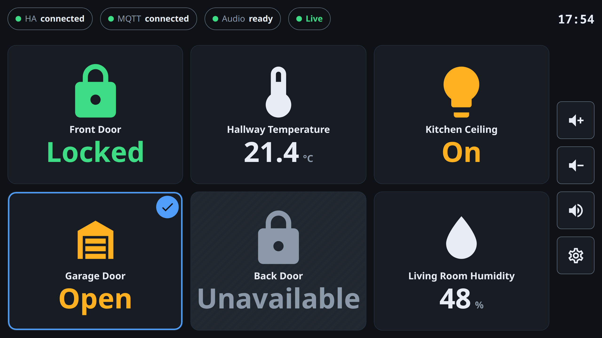

# ChimeDeck

**A wall panel that shows what matters and a speaker Home Assistant can ring for anything.**

[Home Assistant](https://www.home-assistant.io/) knows every event in your house. ChimeDeck is the
part in the hallway that *says so* — the doorbell, the laundry, the garage left open at midnight —
and the part you can point at to say *"this one, right now"*.

No cloud. No account. No vendor. A cheap Linux box, your Home Assistant, your MQTT broker.

[](LICENSE)
[](pyproject.toml)
[](#what-you-need)


<p align="center">
  <br>
  <sub>Kiosk mode, exactly as it runs on the wall: 1280×720, live states over the Home Assistant
  websocket. The blue outline and tick mean <b>Garage Door</b> is selected — and Home Assistant can
  see that.</sub>
</p>

| | |
| --- | --- |
| **Runs on** | any 64-bit Linux box: a Raspberry Pi, an old NUC, a thin client |
| **Needs** | Python 3.11+, a Home Assistant token, an MQTT broker |
| **Never needs** | cloud, account, subscription, or a fast CPU |
| **Dashboard** | `127.0.0.1:8080` — loopback only, deliberately unauthenticated |
| **Settings** | `0.0.0.0:8081` — configuration only, password protected |
| **Tests** | 2,630 backend · 1,008 frontend · 99 real-browser |

---

## Contents

[Why](#why-you-would-want-this) ·
[What it does](#what-it-does) ·
[The automation](#one-switch-one-button-one-automation) ·
[Install](#install) ·
[Hardware](#what-you-need) ·
[Speech](#speech-without-the-subscription) ·
[Architecture](#how-it-fits-together) ·
[Security](#two-listeners-and-why-that-matters) ·
[Quality](#built-to-be-believed) ·
[Limits](#what-it-deliberately-does-not-do) ·
[FAQ](#faq) ·
[Docs](#documentation) ·
[Status](#status)

---

## Why you would want this

A doorbell chime is single-purpose: one noise, one event, one vendor. But your house already knows
about the dryer, the gate, the freezer door, the washing machine. The only missing piece is
something in the hallway that can *speak* — and that you can point at.

ChimeDeck deliberately knows none of your rules. It shows what you tell it to show and plays what
you tell it to play. **The policy lives in Home Assistant**, in a YAML file you already own, version
and can undo — not in a black box with an app store.

---

## What it does

**The panel**

- Any Home Assistant entity as a large tile: icon, name, state — readable from across a room.
- Numeric entities carry their unit; unavailable entities say *unavailable* instead of going blank;
  every state is a **word**, never colour alone.
- Fills whatever resolution and aspect ratio the screen offers, with an optical scale setting for a
  high-DPI panel whose mode you cannot change.
- Four big controls on the right: volume up, volume down, mute, settings. 80 px targets, 5 % a tap.

**The chimes**

- Every chime is a real `button` entity in Home Assistant. Press it from an automation, a dashboard,
  a physical button, a voice assistant — the sound comes out of *this* box's speaker.
- Each one plays a sound file, a downloaded URL, or speaks a sentence.
- Per button: dedupe window (a bouncing contact rings once), its own volume, quiet-hours exemption.
- A press log of the newest 1,000 presses: what played, how long it took, whether it was suppressed.

**The speech**

- Five engines, from robotic-and-instant to natural-and-local to your Home Assistant's own voice.
- Sentences can contain live state, rendered by Home Assistant at the moment of the press.
- Fixed phrases are rendered **once** and reused forever — 1,000 presses, one TTS request.

**The plumbing**

- Configuration via a web UI and a first-run wizard. No config file, no YAML editing on the device.
- Import/export the whole configuration as JSON.
- Runs as systemd user units, with a kiosk wrapper and Docker images if you want them.

### Setting one up

<p align="center">
  
</p>

---

## One switch, one button, one automation

Tapping a tile does not open a menu and does not do anything in ChimeDeck: it publishes an MQTT
`switch` — *"this is the thing I care about right now"* — that Home Assistant can watch, act on and
clear.

Tap **Dryer** when you load it. When the load finishes, Home Assistant rings a chime and turns the
tile off again:

```yaml
automation:
  - alias: "Dryer finished — chime, then clear the tile"
    triggers:
      - trigger: state
        entity_id: switch.chime_deck_dryer
        to: "on"
    actions:
      - action: button.press
        target:
          entity_id: button.chime_deck_dryer_done
      - action: switch.turn_off
        target:
          entity_id: switch.chime_deck_dryer
```

And a chime whose sentence contains a live value:

```yaml
automation:
  - alias: "Front door — say who is expected"
    triggers:
      - trigger: state
        entity_id: binary_sensor.front_door_contact
        to: "on"
    actions:
      - action: button.press
        target:
          entity_id: button.chime_deck_announce
```

…where that chime's phrase is `{{ states('sensor.next_visitor') }} is here to see you`, rendered by
Home Assistant when the bell rings.

Every chime and every selectable tile lands on **one Home Assistant device**, so the names are
predictable:

| You want | Entity |
| --- | --- |
| to ring a chime | `button.chime_deck_<slug>` |
| to know a tile is selected | `switch.chime_deck_<slug>` |
| to change a selection from HA | `switch.turn_on` / `switch.turn_off` on that entity |

No doorbell-side logic, no second place to keep rules in sync. Rename the panel, rearrange the
tiles, re-flash it — the automation does not change.

---

## Install

```bash
git clone https://github.com/insanemal/chime-deck
cd chime-deck
sudo apt install libmpv2 libportaudio2 ffmpeg espeak-ng    # Debian / Raspberry Pi OS
uv sync
uv run chime-deck
```

It tells you where it is, and it tells you when you are exposed:

```
INFO chime_deck.app startup: 5/7 listening on http://127.0.0.1:8080
INFO chime_deck.app admin listener on 0.0.0.0:8081 — configuration only; the dashboard is not served there
WARNING chime_deck.app the configuration interface on 0.0.0.0:8081 is UNPROTECTED — anyone who can
  reach that address can read and change these settings, including each tile's current state; set a password
```

Open `http://<this-box>:8081` from your phone or laptop. The wizard asks for your Home Assistant URL
and token and your MQTT broker, then you pick tiles and chimes. That is the entire setup.

<p align="center">
  
</p>

For a real installation — systemd **user** units, `loginctl enable-linger`, upgrades, backups — read
[`docs/installing.md`](docs/installing.md). For a panel on a wall, [`docs/kiosk.md`](docs/kiosk.md)
covers the Chromium wrapper, seat and DRM problems, pinning a display mode, and what to do when the
mode cannot be changed at all.

Docker works: the multi-stage `Dockerfile` and `deploy/docker-compose.yml` ship, and a `v*` tag
publishes `amd64` + `arm64` images. The native install stays the recommended path, because audio
passthrough and the kiosk browser are inherently host-shaped.

---

## What you need

| | |
| --- | --- |
| **A box** | 64-bit Linux, 1 GB RAM is enough. Sound comes out of *this* box |
| **A display** | anything Chromium can drive; a touchscreen is nicer |
| **A speaker** | HDMI, analogue, or a cheap USB DAC — the quieter the better, the panel turns it up |
| **Home Assistant** | plus a long-lived token: *Profile → Security → Long-lived access tokens* |
| **An MQTT broker** | the Mosquitto add-on is the usual choice |

The reference build is a 1 GB ARM board with a USB DAC and a 1280×720 touchscreen, running the app
and a Chromium kiosk on the same device. Speech is offloaded to Home Assistant there, because the
board would rather not run a neural voice.

---

## Speech, without the subscription

The panel can speak with its own voice, borrow Home Assistant's, or ask a bigger machine. What it
will never do is make you subscribe to hear your own doorbell.

| Engine | Runs where | Needs |
| --- | --- | --- |
| `espeak_ng` | the panel | ~2 MB, robotic but instant |
| `ha_tts` | your Home Assistant | nothing on the panel |
| `remote_tts` | another Linux box | a token, one command to start |
| `http_tts` | a cloud provider | an API key; paid providers bill per character |
| `piper` | the panel | ~2 GB RAM, natural-sounding, offline |

Two properties make this cheap in practice:

1. **Fixed phrases are baked once.** A phrase with no live values is rendered to audio and reused
   forever, so the thousandth press costs nothing and sounds instantaneous.
2. **Templated phrases are re-rendered per press** — the only ones that hit the network — and the UI
   warns you which kind you have written.

A 1 GB panel is therefore a perfectly good doorbell: it only has to *play* audio, never generate it.

---

## How it fits together

```
┌─────────────────────────────────────────────────────────────────┐
│ ChimeDeck — one process, one speaker                            │
│                                                                 │
│  Home Assistant ──▶ MQTT bridge ──▶ press queue ──▶ speaker     │
│                                                                 │
│  Home Assistant ◀── websocket ──▶ tile states, live             │
│                 ◀── MQTT ────────  selection switches (tap)     │
│                                                                 │
│  web UI ──▶ kiosk browser on the wall                           │
└─────────────────────────────────────────────────────────────────┘
```

One Python process serves the dashboard, holds the Home Assistant websocket, owns the MQTT
connection and drives the audio engine. The browser is a renderer, never an audio path: the sound
always comes out of the box itself, which is the one thing that never moves elsewhere.

---

## Two listeners, and why that matters

| Listener | Default | Serves |
| --- | --- | --- |
| app | `127.0.0.1:8080` | everything: the dashboard, the API, the live websocket |
| admin | `0.0.0.0:8081` | configuration only — `/` redirects to `/settings` |

The dashboard is **loopback-only and unauthenticated on purpose**: a wall display cannot log in, so
it must never be reachable from the network. Configuration is a separate listener with a password.
If a ChimeDeck dashboard answers on your LAN, that is a misconfiguration, not a feature.

---

## Built to be believed

Five tiers, and every result should say which one it came from:

| Tier | Command | Proves |
| --- | --- | --- |
| Unit | `uv run pytest -q` | logic, parsing, error paths — stubbed, offline, seconds |
| Integration | `./scripts/test-integration.sh` | real `espeak-ng`, `libmpv`, `ffmpeg` in a container |
| aarch64 | `./scripts/test-integration.sh --board` | the same on the target architecture |
| Frontend | `cd web && npm run verify` | types, WCAG contrast in both themes, component tests, and that the committed bundle is byte-identical to a fresh build |
| Browser | `cd web && npm run test:browser` | the real UI in a real browser against the **real backend** — taps, the rail, settings, live state |

**Two honest limits.** A container plays to a null sink, so "it played" there means "it decoded and
played", never "it was heard". The ARM board plays to real hardware, but only a person in the room
can confirm it was audible — which is why audible acceptance is an owner-assisted pass, not a test.
The full reference is `Project_state/design/07-testing.md`.

The habit behind those numbers: a fix verified on one code path is not verified. Audible volume and
the read-back of a hardware mixer were both "fixed" once and turned out to be fixed only on the code
path the developer's machine used.

---

## What it deliberately does not do

A project that will not say this is usually hiding something.

- **No cloud, no account, no telemetry.** It talks to your Home Assistant and your MQTT broker.
- **No policy engine.** It will not decide that a finished dryer means a particular chime. That lives
  in Home Assistant, in YAML you own, where you can read it in six months.
- **No auth on the dashboard.** Loopback-only by design, as above.
- **No video, no camera, no doorbell hardware.** It is a speaker and a display; pair it with whatever
  button you already like.
- **Not a general-purpose dashboard.** A handful of big tiles, not fifty small ones — readable across
  a room is the constraint that caps how much fits.
- **No bundled voice models.** They are licensed separately; it downloads the voice you choose and
  shows you that voice's licence rather than shipping one.

---

## FAQ

**Do I need a Raspberry Pi?**
No. Any 64-bit Linux box. A thin client or a mini PC is often better and cheaper, and the reference
build is a 1 GB ARM board.

**I do not want any speech. Can I still use it?**
Yes — sound files only is a fully supported setup, with no synthesiser installed and no nagging.

**What happens if Home Assistant goes down?**
The dashboard keeps the last known states and marks them stale, and the header says which connection
is down. Presses come from Home Assistant over MQTT, so nothing rings while it is away — which is
what the header is for.

**Two presses at once?**
The dedupe window suppresses the accidental double-tap, and genuine presses queue and play one at a
time rather than overlapping.

**Can I run more than one panel?**
Yes. Each install has an instance id, so their entities and topics stay apart on one broker.

**Are my sounds and settings stuck in a database?**
No. Export the whole configuration as JSON, and the sounds directory is just files.

**Does it need a fast CPU?**
No. Decoding an MP3 and drawing a page is not hard work. Everything expensive is optional and can
live elsewhere.

**Why not an add-on?**
Because the sound has to come out of the box with the speaker in it. Home Assistant may run in the
cloud or in a cupboard; the chime has to be in the hallway.

---

## Documentation

| | |
| --- | --- |
| [installing.md](docs/installing.md) | packages, the systemd user unit, upgrades, backups, Docker, volume |
| [home-assistant.md](docs/home-assistant.md) | entities, the selection switch contract, automations, troubleshooting |
| [kiosk.md](docs/kiosk.md) | the display: seat and DRM problems, pinning a mode, interface scale |
| [releasing.md](docs/releasing.md) | what a `v*` tag builds and publishes |

If you want to work on it:

| Path | What |
| --- | --- |
| `src/chime_deck/` | Python backend: FastAPI, MQTT bridge, audio engine, TTS |
| `web/` | Svelte 5 frontend; the built bundle in `web/dist` is committed, so a clone runs without Node.js |
| `tests/` | the pytest suite |
| `deploy/` | systemd user units, the kiosk wrapper, the compose file |
| `data/` | runtime state: database, sounds, icons, TTS cache *(git-ignored)* |

Every screenshot in this README is captured from the app's own browser bench — the real backend, the
real HTTP and websocket wire, the real press path, with only the device edges (MQTT broker, audio,
Home Assistant peer) faked. They are regenerated when the UI changes, not taken once and left to rot.

---

## Status

**Working, and in daily use.** Tiles, selection switches, chime buttons, MQTT discovery, the Home
Assistant REST and websocket clients, the audio engine, five TTS engines, quiet hours, the dashboard,
settings and setup wizard, systemd units, the kiosk wrapper and the Docker build are all implemented,
tested, and running on a real panel on a real wall.

What is left on the backlog is an all-in-one flashable image with first-boot Wi-Fi provisioning, and
polish. Not missing functionality.

Bug reports and ideas are welcome — especially ones that arrive with the thing that surprised you,
because that is usually where the documentation is wrong.

---

## Licence

The project's own code is MIT — see [LICENSE](LICENSE).

The Docker images bundle third-party copyleft binaries on top of it, and their
`org.opencontainers.image.licenses` label says so: `MIT AND LGPL-2.1-or-later AND GPL-2.0-or-later AND
GPL-3.0-or-later`. `espeak-ng` (GPL-3.0-or-later), `libmpv2` and `ffmpeg` come from the Debian base
image in *both* tags, so "MIT-only image" would be false of either.

The separate `:piper` tag exists for the optional local Piper engine (`piper-tts`,
GPL-3.0-or-later), which is never bundled in a default install: it is an opt-in extra
(`uv sync --extra piper`) or that second tag. Neither tag bakes a voice model.

Bundled demo sounds are CC0/public domain, with sources recorded alongside them.
